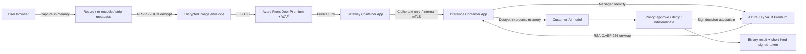
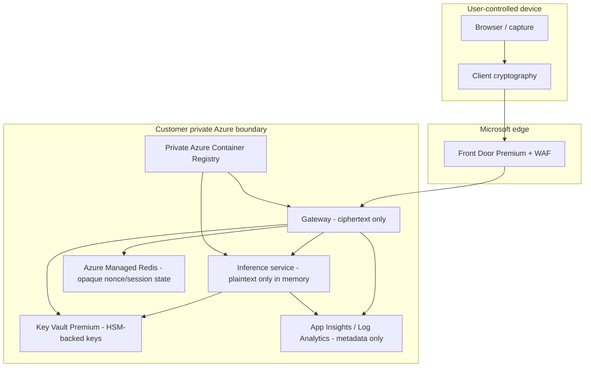
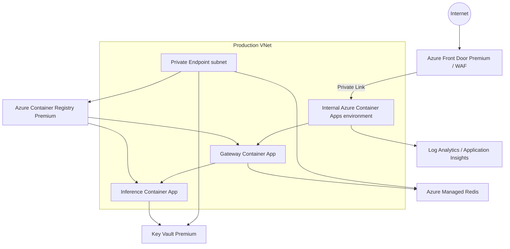
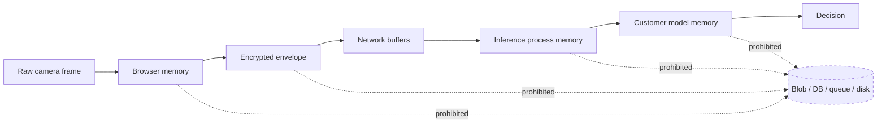
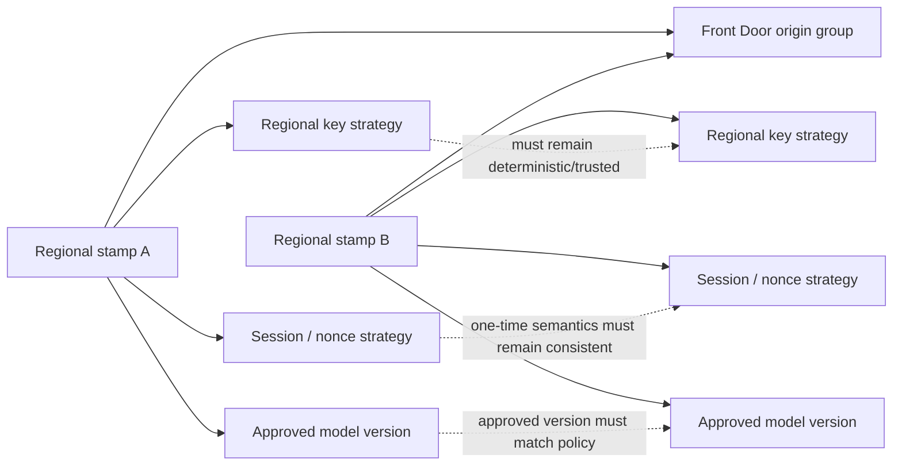

# Architecture diagrams

## Production request flow



## Trust boundaries



## Cryptographic sequence

```mermaid
sequenceDiagram
    participant Browser
    participant Gateway
    participant Inference
    participant KeyVault as Key Vault
    participant Model as Customer model

    Browser->>Gateway: GET /v1/crypto/public-key
    Gateway-->>Browser: Public key + key id
    Browser->>Gateway: POST /v1/session
    Gateway-->>Browser: sessionId + nonce + expiry
    Note over Browser: Re-encode frame; generate AES-256-GCM key and IV
    Note over Browser: Encrypt image and wrap AES key with RSA-OAEP-256
    Browser->>Gateway: POST /v1/verify (ciphertext envelope)
    Gateway->>Gateway: Validate TTL, nonce, schema, rate policy
    Gateway->>Inference: Forward ciphertext envelope
    Inference->>KeyVault: Unwrap AES key using managed identity
    KeyVault-->>Inference: Unwrapped AES key
    Note over Inference: Decrypt image only in process memory
    Inference->>Model: In-memory pixels/tensor
    Model-->>Inference: Transient age estimate/quality
    Note over Inference: Convert to APPROVED / DENIED / INDETERMINATE and discard plaintext, tensors, raw age, AES key
    Inference->>KeyVault: Sign short-lived attestation
    KeyVault-->>Inference: Signature
    Inference-->>Gateway: Decision + signed attestation
    Gateway-->>Browser: approved boolean + attestation; Cache-Control: no-store
```

## Deployment topology



## Data handling invariant



The prohibited paths are architectural requirements, not suggestions. Application code and observability configuration must be tested continuously to ensure request bodies and image-derived artifacts never enter durable storage.

## Failure-mode view

```mermaid
flowchart TB
    GFAIL[Gateway replica fails] --> ACA1[Container Apps]
    ACA1 -->|route to healthy replica| GOK[Healthy gateway replica]

    IFAIL[Inference replica fails] --> ACA2[Internal Container Apps routing]
    ACA2 -->|new request / retry reaches healthy replica| IOK[Healthy inference replica]

    KVFAIL[Key Vault unavailable] --> KVCLOSED[Fail closed\nno verification]
    RFAIL[Managed Redis unavailable] --> RCLOSED[Fail closed for new one-time sessions]
    MFAIL[Customer model unhealthy] --> READY[/ready fails]
    READY --> UNAVAILABLE[Verification denied / unavailable]

    REGION[Regional failure] --> BASELINE[Current baseline unavailable]
    BASELINE --> EXTENSION[Recovery requires approved second regional stamp\nwith coordinated key/session/model semantics]
```

The fail-closed branches are security requirements. A dependency outage must not silently turn into an approval path.

## Multi-region extension dependencies



A second region is not just another Container Apps environment. Key versioning, one-time session semantics, model version, routing, and attestation trust all have to remain deterministic before regional failover can be considered credible.
