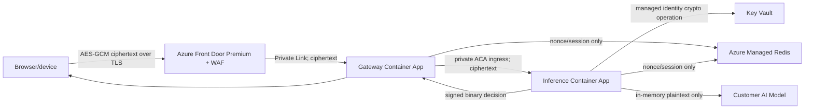

# Architecture Overview

## Trust boundaries

The plaintext image intentionally crosses only the client-memory and inference-memory trust boundaries.

## Why a landing zone

The project's reusable artifact is the secure Azure execution boundary, not a particular model. Organizations can bring their own model container while retaining the same network, identity, key-management, privacy, and operational controls.

## Resource groups

- `<prefix>-network-rg`: VNet, private DNS, private endpoints.
- `<prefix>-platform-rg`: Container Apps environment/apps, ACR, Redis, Front Door/WAF.
- `<prefix>-security-rg`: Key Vault and managed identities.
- `<prefix>-monitor-rg`: Log Analytics and Application Insights.

## Design principles

- Zero public origin exposure.
- No photograph persistence.
- Encryption beyond TLS.
- Passwordless Azure service access.
- Fail closed on uncertainty/security errors.
- Explicit model boundary and governance.
- Minimal data disclosure: external result is binary.
