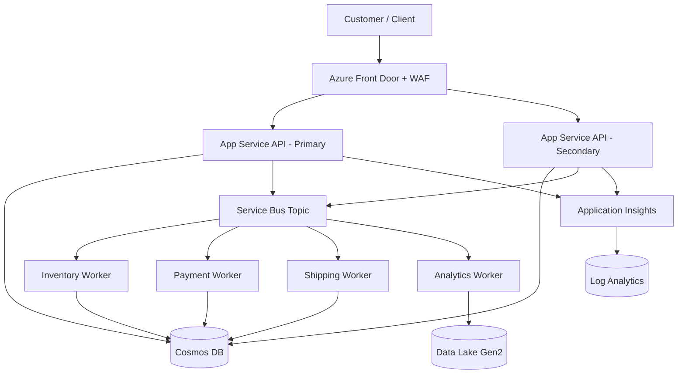
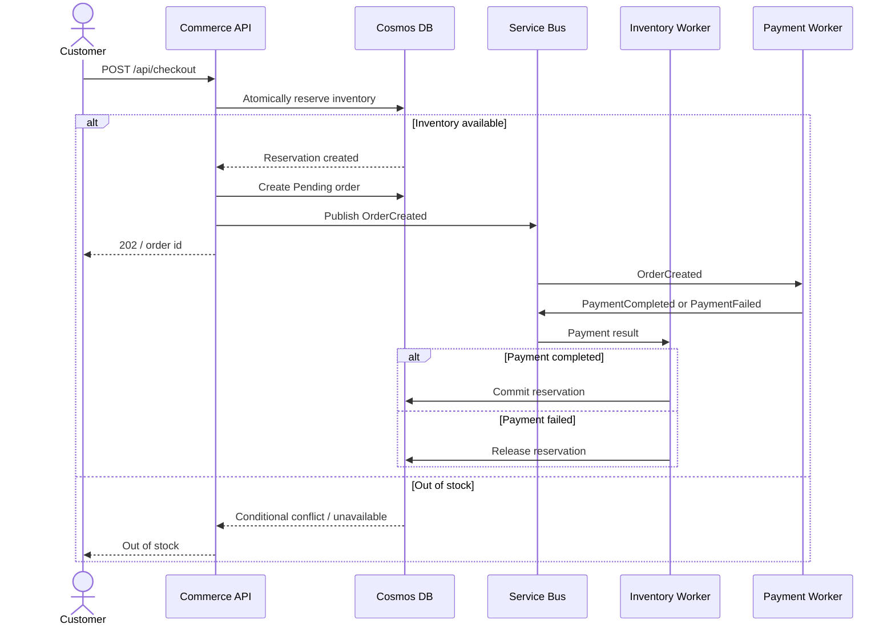
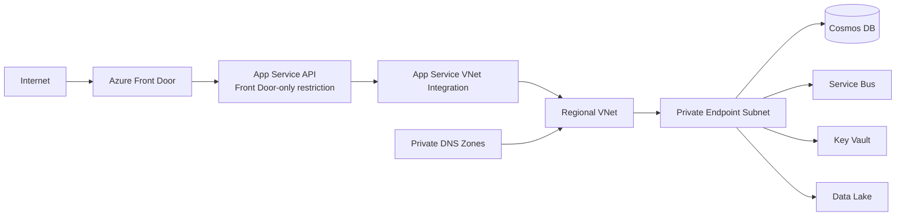
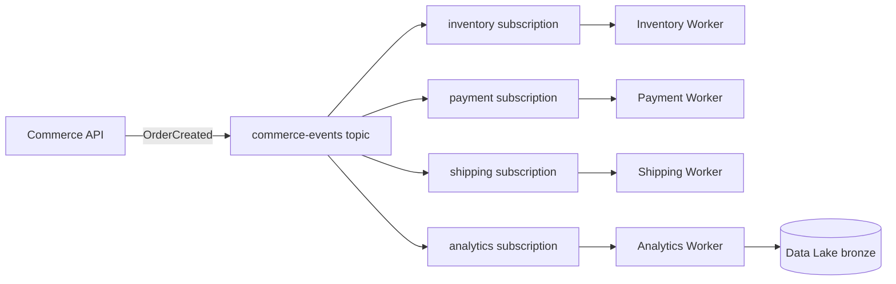
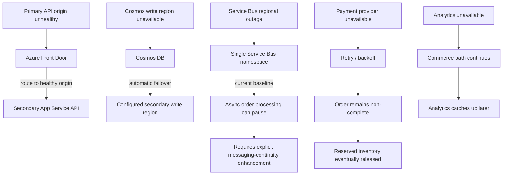
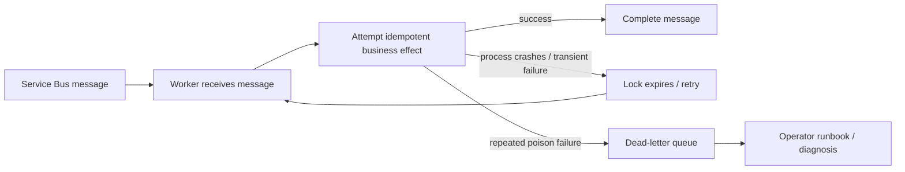

# Architecture Diagrams

These Mermaid diagrams are source-controlled so GitHub can render them directly. Export PNG/SVG versions later for the portfolio site.

## Solution overview

## Checkout and inventory reservation

## Regional network path

## Event flow

## Failure-mode view

This diagram intentionally shows that “two application regions” does **not** make every dependency multi-region. The current messaging namespace remains a separate continuity risk.

## Worker redelivery and dead-letter behavior

The application implementation must make business side effects idempotent; the infrastructure alone cannot guarantee that redelivery is harmless.
