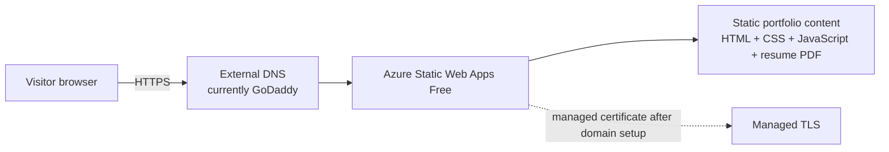
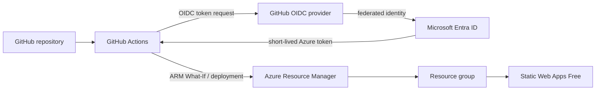
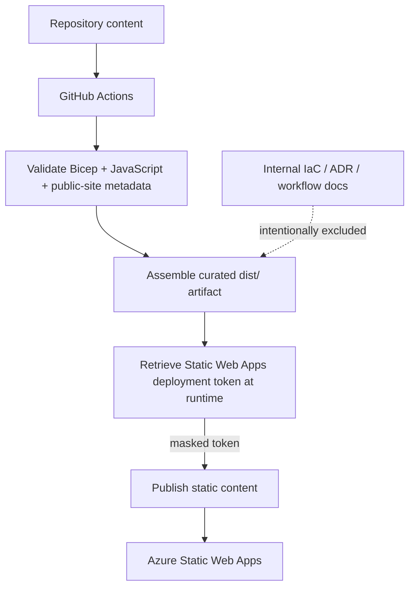
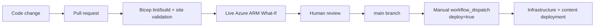
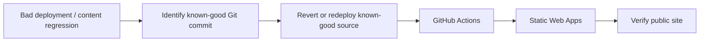
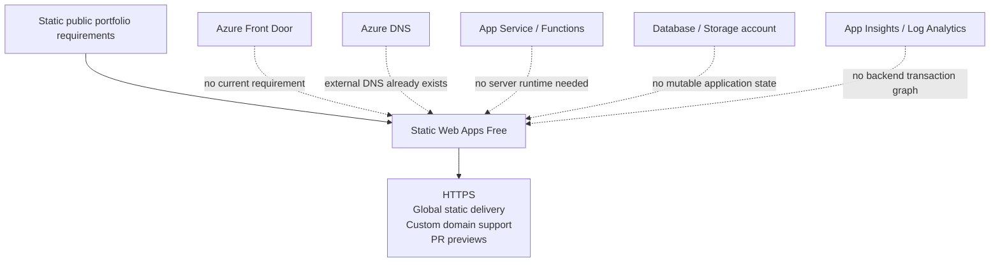

# Architecture Diagrams

These Mermaid diagrams are source-controlled so GitHub can render them directly. They describe the intended production topology and delivery/security paths without implying that the Azure Static Web App has already been deployed.

## Public request path

`holdenjolley.com` remains registered externally. The hosting architecture does not require moving DNS into Azure; the external DNS provider can map the domain to Static Web Apps when the site is deployed.

## Secretless infrastructure delivery path

No reusable Azure client secret is required for GitHub-to-Azure authentication.

## Content publication path

The deployment token is retrieved at runtime and masked rather than stored as a permanent GitHub deployment secret. Only the curated public artifact is published.

## Production change-control path

A merge or push by itself does not create production Azure resources. Production creation remains explicitly manually gated.

## Recovery path

Because the site is stateless and source-controlled, the baseline recovery mechanism is **revert + redeploy**, not database or VM backup restoration.

## Deliberately omitted services

The omission of these services is an architecture decision, not an implementation gap. Each should be reconsidered only when a new requirement justifies the additional cost or operational surface.