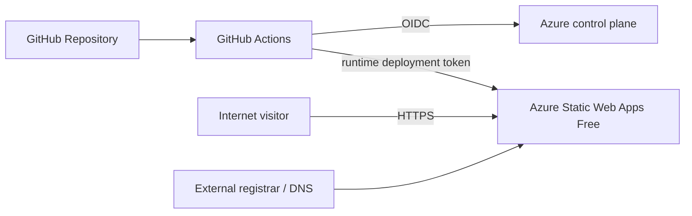

# Architecture Overview

## Requirements

The portfolio workload is public, static, low-risk, read-heavy, globally accessed, and has no server-side state. Those characteristics make a traditional application stack unnecessary.

## Production architecture

## Resource inventory

The baseline Azure deployment contains only:

- one resource group;
- one Azure Static Web Apps resource on the Free SKU.

The site itself is plain HTML/CSS/JavaScript and a PDF resume. No compute process is required after content deployment.

## Availability model

Azure Static Web Apps globally distributes static content, but the Free plan does not include a service-level agreement. This is acceptable for a personal portfolio. If the site becomes business-critical, the workload requirements should be revisited instead of pretending the Free plan provides enterprise availability guarantees.
